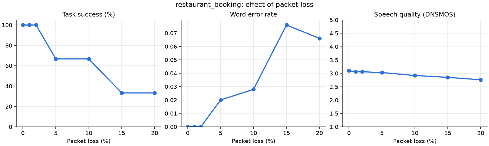

# Jitterbug

**Call-quality testing for voice AI agents.** Jitterbug places scripted test calls to a
voice agent through emulated bad networks (packet loss, jitter, delay, phone-line
codecs). It scores every call for speech quality, word error rate, response latency and
task success, then tells you whether a failed call was **the network's fault or the
agent's**.

```
caller voice ──► [ uplink: loss · jitter · delay · codec ] ──► agent: STT → brain → TTS
     ▲                                                                    │
     └──────────── [ downlink: loss · jitter · delay · codec ] ◄──────────┘
```

## Why

Voice agents run on real phone and internet calls, where audio packets get lost or
arrive late. Many "the AI misheard me" complaints are really network problems, and a
lot of AI failures get blamed on the network. Most voice-agent evaluations score *what
the agent said*. Jitterbug controls *what the agent heard*, so you can see exactly where
a conversation starts to break and why.

## First result: the usual metrics say "fine" while the booking fails

A 3-turn restaurant booking (caller voice in Indian English, agent on local Whisper
`base.en`), swept from 0% to 20% packet loss with bursty losses and 20 ms jitter,
3 runs per level:



| Packet loss | Task success | Mean WER | DNSMOS |
|---:|---:|---:|---:|
| 0–2% | 100% | 0.00 | 3.06–3.10 |
| 5% | 67% | 0.02 | 3.03 |
| 10% | 67% | 0.03 | 2.92 |
| 15–20% | 33% | 0.07–0.08 | 2.76–2.85 |

- **Word error rate never passes 8%, and DNSMOS barely moves.** A dashboard of
  average WER and MOS would call these calls healthy, yet two out of three bookings
  fail. Average metrics miss that **one lost word can fail the whole task**.
- **What gets lost is what matters.** Jitterbug's diagnoses point at single words:
  - *"agent heard 'I'd like to book a table for people please'"*: a 160 ms gap erased
    "four".
  - *"agent heard 'The name is Kupur' / 'Papoor'"*: names are the most fragile detail,
    because no context helps the speech-to-text guess them.
- **Not every failure is the network.** At 5% loss, one call had the right booking but
  a 2.6 s reply. Jitterbug blamed the agent's own processing (2.1 s), not the 160 ms of
  network delay.

These are first numbers from a small sample (3 runs per level, one scenario).
`--seeds 10` and more scenarios give tighter numbers.

## How it works

| Step | What happens |
|---|---|
| **Caller** | A scenario (YAML) lists what the caller says. Each line is spoken with a TTS voice. |
| **Network** | Audio is cut into 20 ms packets. Loss follows a **Gilbert-Elliott** model (bursty, like Wi-Fi and 4G). Each packet gets random **jitter**, and an adaptive jitter buffer drops packets that arrive too late. Gaps are filled by **packet loss concealment**. `narrowband` squeezes audio through an **8 kHz mu-law (G.711)** phone channel. Seeded, so every run is reproducible. |
| **Agent under test** | Any `STT → brain → TTS` pipeline, either Jitterbug's built-in cascade or a real **Pipecat** pipeline (see below). The example bot uses local **Whisper** (faster-whisper) and a rule-based booking assistant, which is deterministic so failures come from what it *heard*. Replies are synthesised sentence by sentence, as streaming frameworks do. |
| **Scoring** | **WER** of what the agent heard vs. what was said, both ways. **DNSMOS** (Microsoft's reference-free P.835 MOS model) on the audio each side received. **Latency** = endpointing + network delay + STT + brain + time to first TTS audio. **Task success** = did the agent end up with the right booking. |
| **Root cause** | Every scenario first runs on a **clean network** as a baseline. A call that fails only on the bad network is a `network` fault, and Jitterbug names the turn, the words that were lost, the packet loss and the longest audio gap. A call that fails on clean too is an `agent` fault. A call that is right but slow is a `latency` fault, split into network delay vs. agent processing. |

## Quick start

Needs Python 3.11+ and [uv](https://docs.astral.sh/uv/). The built-in voices use macOS
`say`. Linux TTS is on the roadmap.

```bash
uv sync --extra models
uv run python scripts/download_models.py          # DNSMOS model, 1.2 MB
uv run jitterbug sweep restaurant_booking         # preset network profiles
uv run jitterbug sweep restaurant_booking --preset loss_sweep --seeds 3   # + chart
```

## Test your Pipecat agent

[Pipecat](https://github.com/pipecat-ai/pipecat) is an open-source Python framework for
voice agents. Jitterbug works with it in two ways (`uv sync --extra pipecat`).

**1. Drop the network emulator into your own pipeline.** It damages the user's audio the
way a bad network would, so you can hear how your bot copes, live:

```python
from jitterbug.integrations.pipecat import NetworkImpairmentProcessor
from jitterbug.network import PRESETS

bad_network = NetworkImpairmentProcessor(PRESETS["mobile_4g_weak"])
pipeline = Pipeline([
    transport.input(),
    bad_network,                 # <- damages what the user says (the uplink)
    stt, user_aggregator, llm, tts,
    transport.output(), assistant_aggregator,
])
# afterwards: bad_network.uplink_stats -> packets sent / lost / late, longest gap
```

It works on frames of any size and sample rate, and changes them in place, so ids and
metadata survive. The same packets are dropped whether audio arrives in 10 ms or 1 s
chunks. `impair_output=True` damages the bot's audio too (the downlink).

**2. Run scripted test calls against a Pipecat bot.** `PipecatAgent` runs your pipeline
once per call in a background thread. It plays the transport and the voice activity
detector (user started speaking → 20 ms audio frames → user stopped speaking). A
Pipecat *observer* records the transcript, the reply, the reply audio and the timings,
so it works however your processors are arranged.

```python
from jitterbug.integrations.pipecat import PipecatAgent

def my_bot():                     # your processors, without the transport
    return [stt, user_aggregator, llm, tts, assistant_aggregator]

runner = CallRunner(agent_factory=lambda: PipecatAgent(my_bot), ...)
```

The repo includes an example Pipecat booking bot that needs no API keys. It uses local
Whisper and macOS voices wrapped as Pipecat services (`EngineSTTService`,
`EngineTTSService`) and the booking brain in the LLM's place:

```bash
uv sync --extra models --extra pipecat
uv run jitterbug sweep restaurant_booking --agent pipecat
```

Same scenario, same seeded network faults; the built-in agent and the Pipecat bot agree:

| Network | Built-in agent | Pipecat bot |
|---|---|---|
| clean | pass, p95 1504 ms | pass, p95 1496 ms |
| busy Wi-Fi (3% loss) | pass, 1829 ms | pass, 1837 ms |
| weak 4G (6% loss) | `network`: lost the word "four" | `network`: lost the word "four" |
| congested (12% loss) | `latency`, 2473 ms | `latency`, 2439 ms |

For your own bot, Jitterbug gives you WER, audio quality and latency per turn. Task
success needs the bot's state (the example passes its `brain`), and an LLM judge for any
bot is on the roadmap.

### HTTP API

```bash
uv run jitterbug serve        # http://127.0.0.1:8000/docs
```

```bash
curl -X POST localhost:8000/runs -H 'content-type: application/json' -d '{
  "scenario": "restaurant_booking",
  "profiles": ["phone_line", {"name": "bad_4g", "loss_pct": 8, "burst_len": 3, "jitter_ms": 60}],
  "seeds": 3
}'
curl localhost:8000/runs/<run_id>                      # status + summary table
curl localhost:8000/runs/<run_id>/calls?verdict=network
curl localhost:8000/calls/<call_id>                    # every turn: said / heard / packets / scores
curl -o heard.wav localhost:8000/calls/<call_id>/audio/turn0_agent_heard.wav
```

| Endpoint | |
|---|---|
| `POST /runs` | Start a sweep (runs in the background, returns `202` + run id) |
| `GET /runs`, `GET /runs/{id}` | Run status, summary table and calls (filled in live) |
| `GET /runs/{id}/calls?verdict=` | Calls in a run, filtered by `pass` / `network` / `latency` / `agent` |
| `GET /calls/{id}` | Full detail of a call, turn by turn |
| `GET /calls/{id}/audio/{file}` | Play back what the agent or the caller heard |
| `GET /scenarios`, `GET /profiles` | What can be tested, and under which conditions |

Storage is SQLAlchemy 2.0. It uses SQLite by default; set `JITTERBUG_DATABASE_URL` to a
PostgreSQL URL (`uv sync --extra postgres`) for production.

## Writing a scenario

```yaml
name: restaurant_booking
caller_voice: Rishi            # Indian English
turns:
  - Hi, I'd like to book a table for four people please.
  - At eight thirty pm tonight.
  - The name is Kapoor.
expected:                      # what the agent must end up with
  party_size: "4"
  time: "8:30 pm"
  name: kapoor
```

## Project layout

```
src/jitterbug/
  network.py      packet loss (Gilbert-Elliott), jitter buffer, concealment, G.711 codec
  speech.py       TTS / STT interfaces, macOS voices, local Whisper
  agent.py        cascade voice agent (STT → brain → TTS) with per-step timing
  runner.py       runs calls turn by turn, sweeps, summary tables
  diagnosis.py    network vs. agent vs. latency root cause
  scoring/        WER with number/time normalisation, DNSMOS
  api/            FastAPI app, SQLAlchemy models, background job queue
  integrations/
    pipecat.py    drop-in network processor, Pipecat services, PipecatAgent adapter
tests/            pytest suite with fake speech engines (no model downloads in CI)
```

## Testing

```bash
uv run pytest            # 65 tests, about 5 s
uv run ruff check . && uv run ruff format --check .
```

Tests use fake speech engines: each word is a short tone, and the fake speech-to-text
drops a word when packet loss destroyed its audio. Network faults still cause failures
the same way they do on a real call, but no models are downloaded. The Pipecat tests run
real Pipecat pipelines (with Pipecat's own `run_test` helper for the processor). GitHub
Actions runs lint, formatting and tests on Python 3.11 and 3.12.

## Roadmap

- [x] Pipecat integration: drop-in network processor and an adapter to test Pipecat bots
- [ ] LLM judge for open-ended scenarios (beyond slot checks)
- [ ] Docker Compose with PostgreSQL + Redis job queue; Piper TTS for Linux
- [ ] Real network mode with Linux `tc netem` (in addition to the in-process emulator)
- [ ] Opus codec at low bitrates
- [ ] Mic-check web page: record 10 s from your mic, get a quality score from the same API

## Limits

- The emulator works on audio frames, not real sockets, so it doesn't model codec
  adaptation or retransmission yet.
- DNSMOS was trained on human speech; on synthetic TTS voices its absolute scores are
  lower, so compare profiles against each other rather than reading single values.
- Latency uses measured CPU time on this machine, so it's a relative comparison, not a
  production benchmark.
- In a live Pipecat pipeline, the network processor reports delay but doesn't hold
  frames back in real time (Pipecat handles input audio immediately). Late packets are
  still dropped, which is how jitter actually damages audio.
- `PipecatAgent` sends "user started/stopped speaking" itself rather than running a
  voice activity detector, so runs stay repeatable. Bots that rely on their transport's
  own VAD or turn-taking settings may behave slightly differently on a real call.
